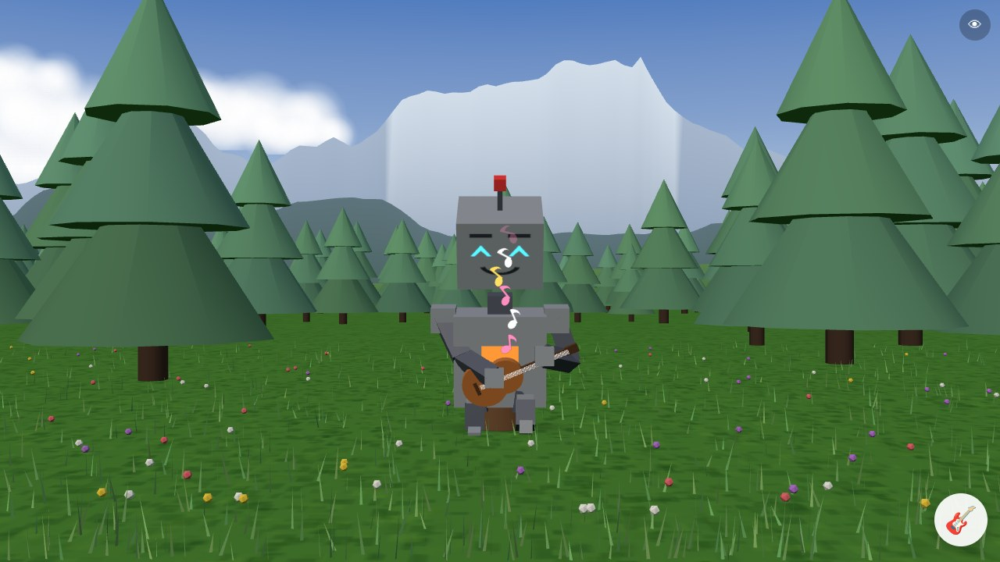
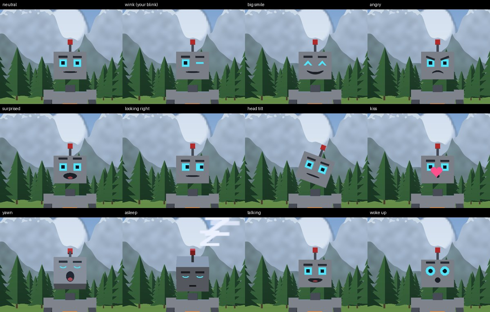
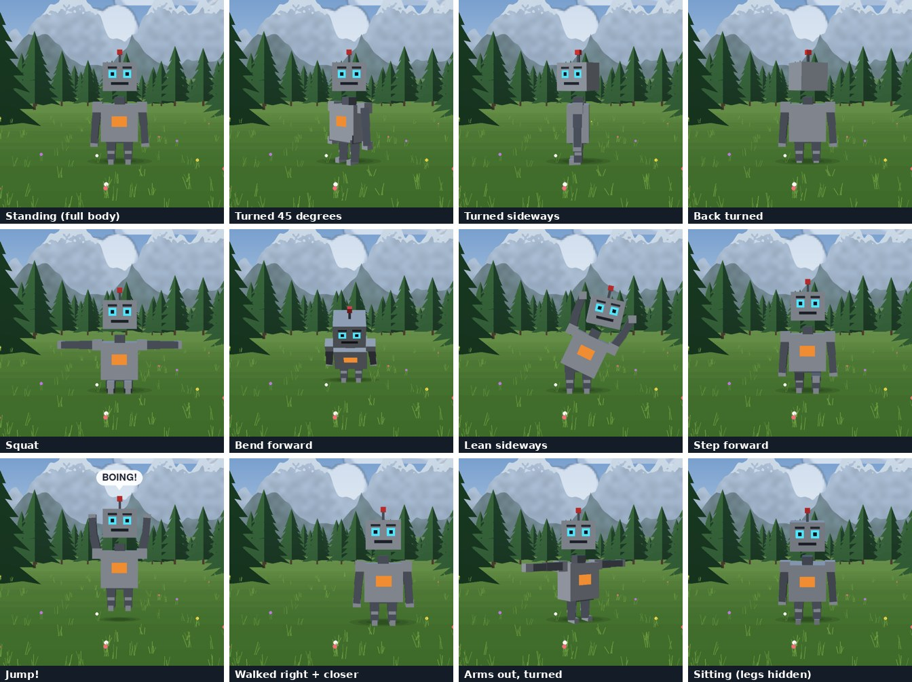
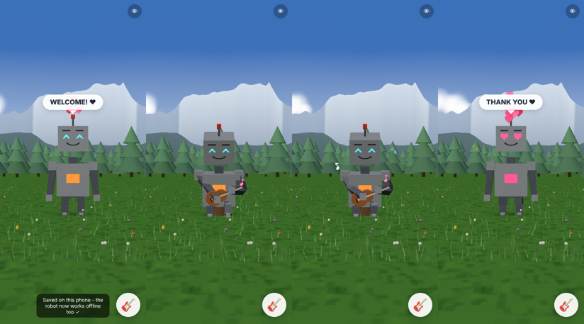

# 🤖 Off-Axis Robot

**A little robot that lives *inside* your screen.** Move your head and the screen acts like a real window into its 3D world. The robot turns to look at you and copies your face, hands and whole body in real time. Everything runs from your webcam: no special hardware, no app store.

### ▶ [Try it in your browser](https://arpitmann.github.io/offaxis-robot/)
Works on Android, iPhone, and laptops. Tap **Start**, allow the camera, then move your head.



---

## What it does

**The window illusion.** The app tracks your head and redraws the scene from exactly where your eyes are, using off-axis (asymmetric-frustum) projection. Leaning left lets you see around the right side of the robot, just like looking through a real window.

**It copies you:**
- **Face:** blinks and winks, smiles, surprise, anger, yawns, kisses, talking, where your eyes are looking, and head nods, shakes and tilts
- **Hands:** arms and every finger, plus gestures. A thumbs up gets hearts, a peace sign gets stars, a heart sign gets "I LOVE YOU", clapping gets "BRAVO!", and both hands up gets confetti
- **Body:** turning around, bending, leaning, squatting, stepping sideways or closer, and jumping ("BOING!")
- **Sleep:** if you close your eyes for a while, it shouts **WAKE UP!**

**Extras:**
- A greeting when it opens (set the name with `--name`)
- A 🎸 button: the robot sits on a tree stump and strums a guitar in time with a song
- A natural scene with mountains, swaying trees and grass, plus simple sound effects
- Optional voice lines recorded in your own voice
- It installs to the home screen and works **offline** after the first visit





---

## Run it on a Mac (desktop version)

```bash
bash install_mac.sh      # one time: sets up its own Python, no Homebrew needed
robot                    # in a new Terminal window
robot --record           # optional: record the voice lines in your own voice
```

Press **Esc** to quit and **C** to show the camera view. The first time, macOS asks for camera access.

## Build the phone / web version yourself

You only need Python 3 and `curl`:

```bash
python3 make_robot_app.py                 # builds ~/Desktop/RobotApp
python3 make_robot_app.py --test          # also gives you a temporary https link to open on your phone
python3 make_robot_app.py --name Alex     # the robot says "Welcome, Alex"
```

To use your own sounds (a welcome message, voice lines, a song for the guitar), drop them in [`my_sounds/`](my_sounds/README.md).

This repository publishes itself: every push to `main` rebuilds the app and puts it on GitHub Pages ([workflow](.github/workflows/pages.yml)).

## How it's built

| | Desktop (`robot.py`) | Web (`web/`) |
|---|---|---|
| Rendering | pygame, hand-written 3D projection | three.js with an off-axis projection matrix |
| Tracking | MediaPipe Holistic | MediaPipe Tasks: face, pose and hand landmarkers (GPU, with automatic CPU fallback) |
| Sound | pygame mixer | Web Audio and the phone's speech voice, with lip-sync from the audio envelope |

The tracking models and libraries are downloaded when you build, so they aren't stored in this repository.

## Credits

- The idea started from [neorx's Off-Axis Projection demo](https://github.com/neorxprod/Off-Axis-Projection-demo).
- Built with [three.js](https://threejs.org) (MIT), [MediaPipe](https://ai.google.dev/edge/mediapipe) (Apache 2.0), pygame, OpenCV and NumPy.

Made by **Arpit Mann** · [arpitmann.com](https://arpitmann.com) · MIT License
